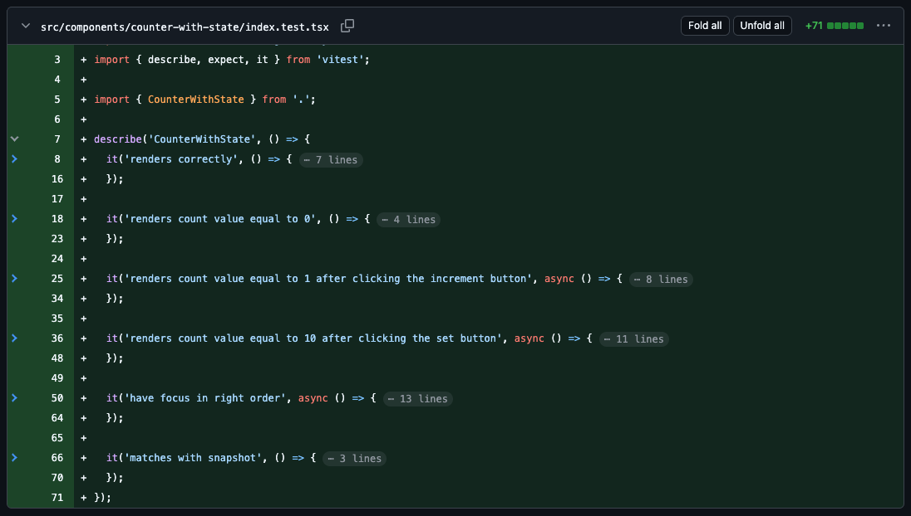

# Origami

IDE-style code folding for GitHub pull request diffs (`/pull/*/changes`) and commit pages, in unified and split view.



- Fold any indented block from the gutter chevron; click the `⋯ N lines` pill to unfold.
- **Fold all / Unfold all** in each file header.
- Optionally auto-folds `it`/`test` and setup hook bodies in `*.test.*` / `*.spec.*` files (toolbar popup).

## Install

```sh
pnpm install
pnpm build
```

Open `chrome://extensions`, enable **Developer mode**, click **Load unpacked** and select `dist`.

## Develop

- `pnpm dev` rebuilds on change; reload the extension afterwards.
- `pnpm lint`, `pnpm typecheck`, `pnpm format`.
- `pnpm icons` regenerates the PNG icons from `assets/icon.svg`.
